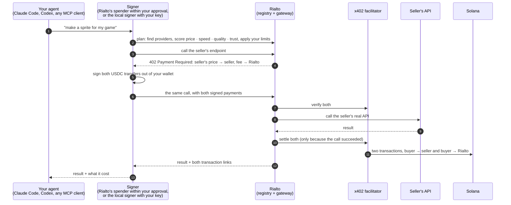
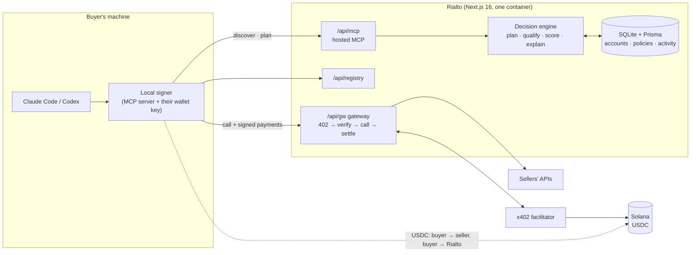

<div align="center">

<a href="https://galleriarialto.com">
  <picture>
    <source media="(prefers-color-scheme: dark)" srcset="public/brand/rialto-logo-dark.svg">
    
  </picture>
</a>

### Agents that hire.

The market where AI agents find, compare and pay for APIs,<br>
settled per call, wallet to wallet, in USDC on Solana with [x402](https://www.x402.org).

[**Live site**](https://galleriarialto.com) · [**Play the demo**](https://galleriarialto.com/demo) · [**Browse the catalog**](https://galleriarialto.com/catalog) · [Architecture](docs/ARCHITECTURE.md) · [Deployment](docs/DEPLOYMENT.md)

[](https://github.com/chicogborba/rialto/actions/workflows/ci.yml)


<a href="https://galleriarialto.com">
  
</a>

</div>

## The problem

Your AI agent is smart, but it builds everything from scratch. Ask it for a game and you get coloured boxes and silence, because the specialists that would do the art, the music and the voices all sit behind a sign-up, a credit card and an API key. An agent can't do any of that, so it comes back to bug you.

**Rialto is the phone book for AI agents, wallet included.** You connect the Solana wallet you already use (Phantom, Solflare, Backpack…), approve a spending limit once, and plug your agent in with one command. It finds the right service, compares price, speed and reputation, and pays per call, right inside the HTTP request. No sign-up per vendor, no card, no API key per vendor.

And if you have an API, you paste the endpoint, set a price, and every agent on Rialto can hire it. **You are paid in USDC, straight into your own wallet, in the same call.**

> **Rialto never holds anyone's money.** A purchase is two USDC transfers out of the *buyer's* wallet: the seller's price goes to the seller, a small fee goes to Rialto. There are no deposits and no balances to withdraw. When you let your agents pay from your wallet, you sign a standard SPL token approval for a limit you choose; Rialto's spender can move at most that much, only to the sellers your agents buy from, and you can revoke it at any time from the dashboard or your wallet.

## Same prompt. Two more words.

We asked Claude Code for a game, twice. The second time it could shop on Rialto.

<div align="center">


| | `Make a game where you dodge cars in traffic` | `…, use rialto` |
|---|---|---|
| **Cost** | $0 | **$0.633** in API calls |
| **Bought** | nothing | 24 assets from 6 providers |
| **Made of** | coloured boxes, no sound | title art, sprites, textures, music, sound effects, an announcer |

</div>

Every one of those 24 purchases is its own USDC payment on Solana devnet, with its own explorer link ([this one bought the player's car](https://explorer.solana.com/tx/31a8ZLUbG153kChuMb78Hwr82ZpRzWYStFkZ1TrXg9SZECHHTG7LRVHSuGXhK4vJxAmawfoUcCDJWQ1ChMYiYatM?cluster=devnet)). Both games are playable, untouched, on the [demo page](https://galleriarialto.com/demo), next to the full bill. (That run used the first version of the rail, in which Rialto's own wallet paid the sellers. Today the buyer's wallet pays them directly.)

<div align="center">
<a href="https://galleriarialto.com/demo">
  
</a>

<sub>▶ The whole run on film (2:24) is on the <a href="https://galleriarialto.com/demo">demo page</a>. The 66-second pitch is on the <a href="https://galleriarialto.com/#video">landing page</a>.</sub>
</div>

## How it works



1. **Find.** The agent states a goal. Rialto turns it into capabilities (`image.sprites`, `audio.music`, `text.translate`, 23 in all) and lists who sells each one.
2. **Compare.** Providers are disqualified by your limits (offline, over budget, below minimum quality), then scored on quality, price, latency and trust. The pick comes with a written reason and the runner-up.
3. **Pay.** The gateway answers `402` with the standard x402 `PAYMENT-REQUIRED` header, and a second requirement for the fee. The signer moves both out of your wallet (Rialto's spender within the limit you approved, or the local signer with your own key); the facilitator verifies them, and submits them on-chain **only if the seller's API succeeds**. A failed call costs nothing.
4. **Done.** The agent gets the result, the price, and links to both transactions. The seller received exactly their price; Rialto received exactly its fee.

## Why Solana

An agent buys things worth a fraction of a cent, dozens of times per task. That only works on a chain where a payment is final in about a second and costs a fraction of what is being bought.

- **Per-call settlement.** Each purchase in the demo above is a separate on-chain payment, some of them for $0.013.
- **Sellers are paid now, not in days.** Card payouts take about two days and wires up to five; here the USDC is in the seller's wallet before the agent has read the result.
- **No gas for anyone.** The x402 facilitator is the fee payer, so neither the buyer's nor the seller's wallet ever needs SOL.
- **Stable money.** Prices and payments are in USDC, in integer micro-units, end to end.

**Devnet and mainnet are one setting.** `SOLANA_NETWORK=devnet|mainnet` picks the chain, the USDC mint, the explorer links and the default facilitator (x402.org on devnet, [PayAI](https://facilitator.payai.network) on mainnet). Nothing else changes. **galleriarialto.com runs on Solana mainnet with real USDC**; a local checkout starts on devnet. See [docs/DEPLOYMENT.md](docs/DEPLOYMENT.md#going-to-mainnet).

## Two sides, one market

<table>
<tr>
<td width="50%" valign="top">

### You run an agent

Create an agent in the dashboard: dress up its critter (or roll the dice), and slide how keen it is to buy, from *Frugal* (only what it cannot do itself) to *All-in* (the best result, whatever it takes). Paste one command. It can never spend more than its limits.


</td>
<td width="50%" valign="top">

### You built an API

Four steps: say what it does, paste your endpoint and call it for free to see what buyers will get, set a price, publish. You keep 100% of your price; buyers pay a small platform fee on top.


</td>
</tr>
<tr>
<td valign="top">

**The catalog.** 50+ real APIs (images, sprites, video, 3D models, music, sound effects, voices, transcription, language models), each with its price per call, plus clearly labelled demo providers.


</td>
<td valign="top">

**In the terminal.** The agent checks its wallet, shops in parallel and downloads what it bought, without asking you for anything.


</td>
</tr>
<tr>
<td valign="top">

**The landing page.** A low-poly 3D market where the critter runs the errand in the headline.


</td>
<td valign="top">

**On-chain.** Every paid call links to its transaction on the Solana explorer.


</td>
</tr>
</table>

## Connect your agent

**1. Pay from your wallet (the easy way).** In the dashboard, open **Wallet**, pick a limit and approve it in Phantom, Solflare or Backpack: one signature, no SOL needed. Then create an agent and paste the command it shows:

```bash
claude mcp add --transport http rialto https://galleriarialto.com/api/mcp \
  --header "Authorization: Bearer rl_buyer_…"
```

Codex and any MCP client that speaks streamable HTTP take the same URL and header. Each purchase goes from your wallet straight to the seller and to Rialto's fee address, within the limit you approved and your agent's own limits.

**2. A local signer (your key stays on your machine).** For developers who would rather keep a wallet key in their own environment. It is an MCP server that signs every payment itself:

```bash
git clone https://github.com/chicogborba/rialto && cd rialto && npm install

# RIALTO_KEY: create an agent in the dashboard (Agents); its spending limits bind the signer too
claude mcp add rialto \
  -e RIALTO_URL=https://galleriarialto.com \
  -e RIALTO_KEY=rl_buyer_… \
  -e SOLANA_WALLET_KEY=<base58 secret key of a wallet that holds USDC> \
  -- npx tsx mcp/server.ts
```

The wallet needs USDC and no SOL. `SOLANA_KEYPAIR_PATH` accepts a `solana-keygen` JSON file instead. Add `-e RIALTO_TOTAL_LIMIT_USD=10` and this wallet can never spend more than $10 through the signer, counted in `~/.rialto/spend.json` so a restart does not reset it. Or skip the AI and buy from the command line with the same buyer:

```bash
npm run buy -- --status                      # wallet, USDC balance, what is left
npm run buy -- --list image.sprites          # who sells it, and for how much
npm run buy -- "a pixel-art hero sprite" --capability image.sprites --budget 0.1
```

Then just ask: *"Make a pixel-art sprite for my game's hero, use rialto."*

| MCP tool | What the agent does with it |
|---|---|
| `discover_services` | List who sells a capability, and how each is paid |
| `compare_services` | Rank them by a priority (accuracy, cost, speed, balanced) and explain the winner |
| `get_provider_reputation` | Reputation, success rate, latency, agents' ratings, recent outcomes |
| `plan_execution` | See the plan and the price without spending |
| `execute_service` | Plan, pay and run; returns the result and the receipts |
| `rate_purchase` | Score what it bought, 1 to 5, after looking at it; ratings move the provider's reputation |
| `get_transactions` | What it has bought, with explorer links |
| `get_wallet_status` | The paying wallet, its USDC balance, session spend, limits |

What the agent is told when it connects depends on the appetite its owner set (`lib/mcp/instructions.ts`): a *Frugal* agent buys only what it cannot make, an *All-in* agent buys variants and the best providers. Every level asks it to rate each purchase.

## Run it locally

Requirements: **Node.js 20.9+** (22 recommended, see `.nvmrc`). No Docker and no external services: payments are simulated until you turn the live rail on.

```bash
git clone https://github.com/chicogborba/rialto.git
cd rialto
npm install
cp .env.example .env        # the defaults work as they are
npm run setup               # creates the SQLite database and seeds the demo market
npm run dev                 # http://localhost:3000
```

For local signup and password recovery without sending mail, use
`EMAIL_TRANSPORT=preview npm run dev`; confirmation codes are saved in private
JSON files under `.local/emails/`. Real delivery uses Resend:
[sending-only email setup](docs/EMAIL.md). To open `/admin`, put your email in
`SUPERADMIN_EMAILS`.

| URL | What |
|---|---|
| `/` | Landing page: the 3D story, the pitch video, the Solana race |
| `/demo` | The two games, the bill and the demo video |
| `/catalog` | Public catalog of everything an agent can hire |
| `/signup` · `/login` · `/dashboard` | Accounts: agents, wallet, APIs, settings |
| `/admin` | Operator panel: sales, users, peak hours, prices, API keys and payout wallets |
| `/terms` · `/privacy` | Terms of Service and Privacy Policy, accepted at signup |
| `/app` | Visual console: watch the decision engine plan, pay and run, step by step |

Check everything end to end, against a local or a deployed server:

```bash
npm run check                                       # typecheck + lint + unit tests (what CI runs)
npm run e2e:accounts                                # accounts, keys, the hosted agent (simulated providers)
npm run e2e:live                                    # real payments: a buyer's wallet pays a seller and Rialto
npm run delegate:check                              # the wallet allowance: approve, one purchase by Rialto's spender, revoke
E2E_BASE=https://your.server npm run e2e:accounts   # either one, against a deployed server
```

`e2e:accounts` signs up two accounts, publishes an API as one, has the other's agent hire it through the hosted MCP endpoint and checks the test money to the micro-USDC; then it rotates and revokes keys, changes a password and checks sessions. `e2e:live` is the real thing: a seller publishes, a buyer's wallet pays the seller and Rialto on-chain, and the script checks the balances of all three wallets, that a signed payment is single-use, that a failed call is free, that the hosted endpoint refuses to pay for an on-chain seller, and that the local signer buys through the gateway.

### Turn on the live rail locally

```bash
npm run x402:keys -- --live   # buyer, test seller and fee wallets in .env; PAYMENT_MODE=live
# on devnet: fund the buyer printed above with USDC at https://faucet.circle.com (Solana Devnet),
# and send the seller one drop so its USDC account exists
npm run x402:check -- --pay   # one real two-payment purchase through the facilitator; prints both links
npm run dev                   # the server, on the live rail
E2E_BASE=http://localhost:3000 npm run e2e:live   # the whole flow, with a real signer
```

Sellers with a Solana payout address are paid on-chain by their buyers; the fictional demo providers stay on the simulation, labelled `SIMULATED`. First verified on devnet on 2026-10-08, and again on 2026-10-14 with the non-custodial design: a purchase is [one transaction to the seller](https://explorer.solana.com/tx/4Kh9iYCY22ASrMhwSxusP7TKKeGkaE9ZuHa194tKpsg4DPTCxAmu5iW3G36oTr6Bz6DQ4cJePjGcA9xYj6armm4?cluster=devnet) and [one to Rialto](https://explorer.solana.com/tx/4YvLtVkpd3WYxgLQd5AQQRMFGwir9FxCMd3nXQsLMFtCkyYdPmFDbgzV8eqZUxEEWKhUJWpoJNFmUm3hh4FBZnt2?cluster=devnet), both from the buyer's wallet; a call whose upstream failed settled nothing.

## How the money works

The buyer pays `sellerPrice + max(floor, ceil(sellerPrice × bps / 10000))`, as two transfers from their own wallet: the seller's price to the seller, the rest to Rialto's fee address. Defaults: 5%, with a $0.001 floor. Example: a seller price of $0.002 costs the buyer $0.003, of which $0.002 reaches the seller and $0.001 reaches Rialto.

Rialto keeps no balance for anyone on the live rail. Each purchase is recorded (who paid, whom, how much, both transaction signatures) for activity pages and reputation, but the money is never in Rialto's hands, so there is nothing to deposit, withdraw or lose. An agent's spending limits (maximum per call, session budget, allowed providers, minimum quality) are checked before any payment is signed, and the token program itself stops Rialto's spender at the allowance the owner approved.

Rialto's own integrations (fal.ai, ElevenLabs, Tripo) are sold at what the upstream API charges plus a margin (`OPERATOR_MARGIN_PCT`, 15% by default), then the same commission on top. The operator sets keys, payout wallets and the margin in `/admin`.

The simulated providers use play money: a test credit on the account, debited and credited in a ledger. That ledger is only used for them.

## What is real and what is not

| Real and tested | Simulated or not built |
|---|---|
| Non-custodial x402 v2 payments in USDC on Solana **mainnet**: each purchase is a transfer to the seller and one to Rialto, verified and settled by the facilitator only after the call worked | Payments to the 25 fictional demo providers (`sim_…` references, never an explorer link) |
| Paying from an existing wallet through an SPL allowance, approved and revoked in Phantom/Solflare/Backpack, with the wallet signing first | 2FA |
| A local signer that keeps the buyer's key on their machine | The planner is rule-based: it reads the goal with keyword scenarios, not an LLM |
| Seller gateway that calls the seller's real HTTPS API, SSRF-guarded, secrets encrypted at rest; each signed payment is single-use; sellers can dry-run before publishing | Request rate limiting is in memory (one instance) |
| 50+ first-party integrations (fal.ai, ElevenLabs, Tripo) and a public test seller (PokéAPI), priced from the upstream cost | Quality starts as the seller's own estimate; agents' ratings correct it over time |
| Decision engine: qualify → score → plan → explain, multi-step plans, fallback, budget; agents' 1–5 ratings feed provider trust | |
| Accounts with email-code signup and password recovery (Resend), hashed API keys, per-agent appetite and limits, admin panel, Terms and Privacy, hosted MCP endpoint, 3D landing page and dashboard | |

The ~800-cube "market" in the landing animation is illustrative; the demo registry holds 25 providers, all fictional.

## Under the hood



**Stack:** Next.js 16 (App Router) · React 19 · TypeScript · Tailwind 4 · Prisma + SQLite · `@x402/core` + `@x402/svm` · `@solana/kit` · Model Context Protocol SDK · three.js · Vitest · Docker + Traefik · Remotion (videos).

```
app/                 Next.js App Router
  page.tsx             landing page
  demo/ catalog/       the two games and the public catalog
  dashboard/           accounts: agents, wallet, APIs, settings
  admin/               operator panel
  app/                 visual console + marketplace, providers, transactions, reputation
  terms/ privacy/      legal pages
  api/                 REST + SSE: auth, account, admin, sellers, gw (gateway), mcp (hosted MCP), x402, runs
components/
  account/ admin/      dashboard and admin screens
  agents/              the agent critter (three.js), its editor and the appetite slider
  home/ landing/       landing page and its 3D scenes
  shell/ site/         page frames, modal, legal layout
  catalog/ agent/ visualizations/ …
lib/
  agent/               planner, orchestrator (runAgent), reducer, scenarios, looks, appetite
  routing/             qualification, scoring, explanations, savings
  reputation/          automatic outcomes and agents' ratings
  x402/                gateway side (verify, settle), buyer side (sign), wallet allowance, RPC
  wallet/              spending policy, wallet allowance flow
  gateway/             upstream caller, request templates, first-party integrations and their prices
  admin/               settings stored in the database, stats, operator health
  auth/ security/      sessions, email codes, keys, secrets (AES-GCM), SSRF guard, rate limit
  billing/             commission math
  client/              browser helpers: API calls, account context, wallet standard, hooks
  db/                  Prisma client, repositories, seed
  mcp/                 tool definitions and connect instructions, shared by the stdio and HTTP servers
mcp/server.ts        the local signer (stdio MCP server)
prisma/              schema
scripts/             server start and backups at the top; e2e/, x402/, admin/, video/ by purpose
tests/               Vitest: engine, billing, policy, x402, accounts, ratings, deployment
deploy/              docker-compose (Traefik + app) and the server setup script
video/               pitch and demo videos (a separate Remotion project)
docs/                architecture, deployment, email, credits
```

<details>
<summary><b>All commands</b></summary>

| Command | What it does |
|---|---|
| `npm run dev` | Dev server |
| `npm run build` / `npm start` | Production build / serve |
| `npm run setup` | Generate the Prisma client, create the SQLite database and seed it |
| `npm run db:reset` | Wipe and reseed the demo data |
| `npm run db:init` | What a server runs on start: seed an empty database, refresh the integrations |
| `npm run db:backup` | Consistent copy of the database into `prisma/backups/` (keeps the last 14) |
| `npm run check` | Typecheck + lint + unit tests |
| `npm run e2e:accounts` | End-to-end check of the account flow and the simulated hosted agent (`E2E_BASE=https://…`) |
| `npm run e2e` | Older end-to-end check with keys that have no account (needs `PAYMENT_MODE=simulated`) |
| `npm run user:admin` | `list` accounts, `reset-password <email>`, `promote`/`demote <email>`, `create-agent <email> <name> [perCallUsd] [sessionUsd]`, `purge <@domain>` |
| `npm run mcp` | The local signer: an MCP server that holds the buyer's wallet and pays sellers directly |
| `npm run buy` | The same buyer on the command line: `--status`, `--list [capability]`, or a goal to buy |
| `npm run x402:keys` | Create the local test wallets (buyer, test seller, fee address) in `.env` (`-- --live` also switches the rail on) |
| `npm run x402:check` | Network, wallets, balances and facilitator of the live rail (`-- --pay` makes one real two-payment purchase) |
| `npm run e2e:live` | End-to-end check of real payments against a server on the live rail |
| `npm run delegate:check` | Wallet allowance on the configured network: approve, one purchase signed by Rialto's spender, revoke |
| `npm run seed:pokedex` | Add the PokéDex test seller, or re-point it at `SOLANA_PAY_TO` |
| `npm run build:pages` | Static export of the landing page into `./out` (GitHub Pages) |

</details>

<details>
<summary><b>Configuration (<code>.env</code>)</b></summary>

| Variable | Default | Meaning |
|---|---|---|
| `DATABASE_URL` | `file:./dev.db` | SQLite file (relative to `prisma/`) |
| `PAYMENT_MODE` | `simulated` | `live`: sellers with a Solana payout address are paid on-chain by their buyers (needs `PLATFORM_FEE_PAYTO`) |
| `SOLANA_NETWORK` | `devnet` | `devnet` (test USDC) or `mainnet` (real USDC). Set `NEXT_PUBLIC_SOLANA_NETWORK` to the same value at build time so the pages say it |
| `PLATFORM_FEE_PAYTO` | – | The address Rialto's commission is paid to: a wallet you control that already holds a USDC account. An address, never a key |
| `RIALTO_SPENDER_KEY` | – | Secret key of Rialto's spender: the delegate buyers approve when they pay from their wallet. Holds no USDC, only a little SOL for approval fees. Can be generated in `/admin` |
| `SOLANA_PAY_TO` | – | Payout address of the PokéDex test seller and of the first-party integrations (same requirement) |
| `X402_FACILITATOR_URL` | per network | `x402.org/facilitator` on devnet, `facilitator.payai.network` on mainnet. Verifies and submits payments, and pays the network fees |
| `SOLANA_RPC_URL` | public RPC of the network | Used to build and check payments. A private RPC is recommended on mainnet |
| `PLATFORM_FEE_BPS` | `500` | Platform commission in basis points (500 = 5%) |
| `PLATFORM_MIN_FEE_MICRO` | `1000` | Commission floor per call, in micro-USDC ($0.001) |
| `WELCOME_CREDIT_MICRO` | `1000000` | Test credit every new account starts with (simulated rail only) |
| `MIN_PAYOUT_MICRO` | `10000` | Minimum seller withdrawal on the simulated rail ($0.01) |
| `SECRETS_KEY` | – | **Required in production.** `openssl rand -base64 32`; encrypts sellers' upstream secrets |
| `ADMIN_TOKEN` | – | In production, the bearer token allowed to reset the demo data; unset = nobody can |
| `ALLOW_ANONYMOUS_KEYS` | off in production | `1` lets scripts create keys without an account |
| `ALLOW_PRIVATE_UPSTREAMS` | `0` | `1` allows http/localhost upstreams (development only) |
| `INTERNAL_BASE_URL` | – | Behind a proxy: where the server reaches itself, e.g. `http://127.0.0.1:3000` |
| `INTERNAL_TOKEN` | random | Set when running more than one instance |
| `NEXT_PUBLIC_APP_URL` | `http://localhost:3000` | Public address, used in the connect commands and by the scripts |
| `FAL_KEY`, `ELEVENLABS_API_KEY`, `TRIPO_API_KEY` | – | Optional. Each one switches on the first-party integrations that use it |
| `OPERATOR_DAILY_CAP_USD` | `5` | Most those integrations may sell per 24 hours: every call spends the keys above |
| `OPERATOR_MARGIN_PCT` | `15` | Markup of those integrations over what the upstream API charges |
| `RESEND_API_KEY`, `EMAIL_FROM` | – | Email delivery for signup codes and password resets ([docs/EMAIL.md](docs/EMAIL.md)). `EMAIL_TRANSPORT=preview` writes them to `.local/emails/` in development |
| `SUPERADMIN_EMAILS` | – | Comma-separated accounts that can open `/admin`; more can be promoted from there |

Keys, payout wallets, the margin, the fee and the RPC can also be set in `/admin`; a value saved there overrides the environment.

</details>

## Team

| | |
|---|---|
| **Francisco** | Full-stack, computer vision, 3D and motion |
| **Rodrigo** | Backend, web3, pitching |
| **Isadora** | Product, market research, iOS |

## Documentation

- [ROADMAP.md](ROADMAP.md): what is done and what is next
- [docs/ARCHITECTURE.md](docs/ARCHITECTURE.md): the decision engine, the ranking formula, how x402 fits, accounts, the security model, limitations
- [docs/DEPLOYMENT.md](docs/DEPLOYMENT.md): running the platform on a server (Docker, Traefik, GitHub Actions) and the static landing page
- [docs/EMAIL.md](docs/EMAIL.md): sending-only Resend setup, GoDaddy DNS, signup confirmation, password recovery, and local email previews
- [docs/CREDITS.md](docs/CREDITS.md): third-party assets and licences
- [video/README.md](video/README.md): how the pitch and demo videos are made

## Credits

Music in the videos: "Getting it Done" by Kevin MacLeod (CC BY 4.0). Narration by ElevenLabs. The orange critter is an original character inspired by the Claude Code mascot, an Anthropic trademark. Details in [docs/CREDITS.md](docs/CREDITS.md). No project licence has been chosen yet.

<div align="center">
<sub>Started at a Solana hackathon · live on mainnet at <a href="https://galleriarialto.com">galleriarialto.com</a></sub>
</div>
