<div align="center">

<a href="https://galleriarialto.com">
  <picture>
    <source media="(prefers-color-scheme: dark)" srcset="public/brand/rialto-logo-dark.svg">
    
  </picture>
</a>

### Agents that hire.

The market where AI agents find, compare and pay for APIs,<br>
settled per call in USDC on Solana with [x402](https://www.x402.org).

[**Live site**](https://galleriarialto.com) · [**Play the demo**](https://galleriarialto.com/demo) · [**Browse the catalog**](https://galleriarialto.com/catalog) · [Architecture](docs/ARCHITECTURE.md) · [Deployment](docs/DEPLOYMENT.md)

[](https://github.com/chicogborba/rialto/actions/workflows/ci.yml)


<a href="https://galleriarialto.com">
  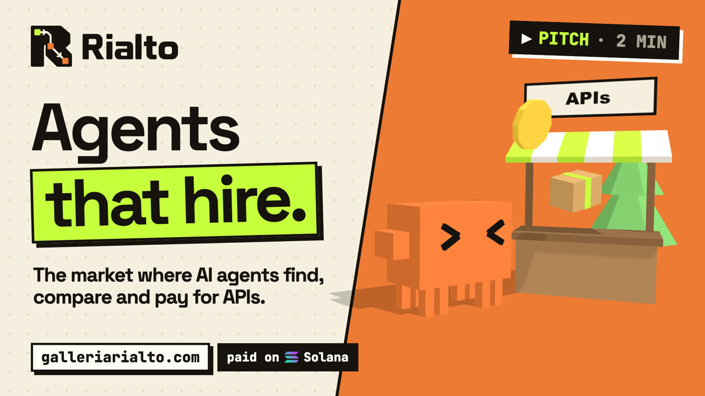
</a>

</div>

## The problem

Your AI agent is smart, but it builds everything from scratch. Ask it for a game and you get coloured boxes and silence, because the specialists that would do the art, the music and the voices all sit behind a sign-up, a credit card and an API key. An agent can't do any of that, so it comes back to bug you.

**Rialto is the phone book for AI agents, wallet included.** You give your agent one key and a spending limit. It finds the right service, compares price, speed and reputation, and pays per call, right inside the HTTP request. No sign-up, no card, no key per vendor.

And if you have an API, you paste the endpoint, set a price, and every agent on Rialto can hire it. You are paid in USDC on every successful call.

## Same prompt. Two more words.

We asked Claude Code for a game, twice. The second time it could shop on Rialto.

<div align="center">

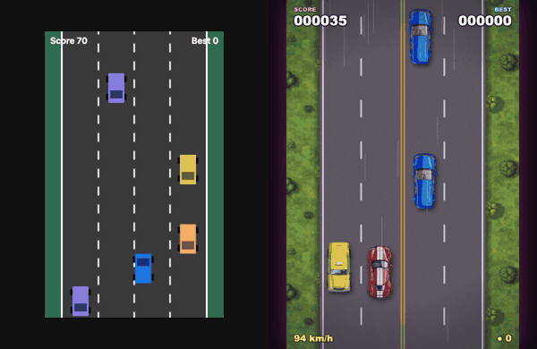

| | `Make a game where you dodge cars in traffic` | `…, use rialto` |
|---|---|---|
| **Cost** | $0 | **$1.08** |
| **Bought** | nothing | 24 assets from 6 providers |
| **Made of** | coloured boxes, no sound | title art, sprites, textures, music, sound effects, an announcer |

</div>

Every one of those 24 purchases is its own USDC payment on Solana devnet, with its own explorer link ([this one bought the player's car](https://explorer.solana.com/tx/31a8ZLUbG153kChuMb78Hwr82ZpRzWYStFkZ1TrXg9SZECHHTG7LRVHSuGXhK4vJxAmawfoUcCDJWQ1ChMYiYatM?cluster=devnet)). Both games are playable, untouched, on the [demo page](https://galleriarialto.com/demo), next to the full bill.

<div align="center">
<a href="https://galleriarialto.com/demo">
  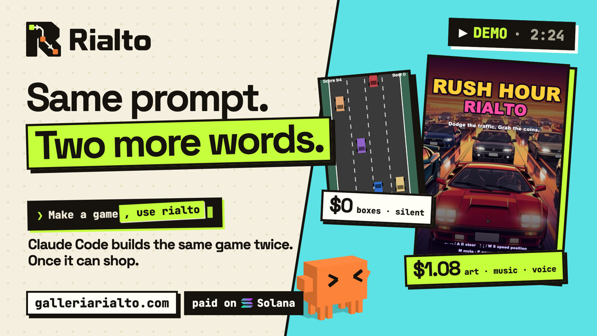
</a>

<sub>▶ The whole run on film (2:24) is on the <a href="https://galleriarialto.com/demo">demo page</a>. The 66-second pitch is on the <a href="https://galleriarialto.com/#video">landing page</a>.</sub>
</div>

## How it works

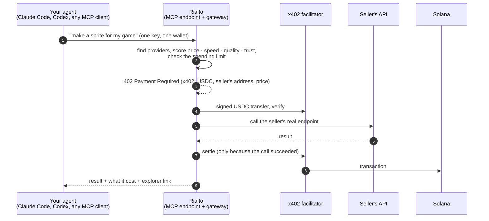

1. **Find.** The agent states a goal. Rialto turns it into capabilities (`image.sprites`, `audio.music`, `text.translate`, 23 in all) and lists who sells each one.
2. **Compare.** Providers are disqualified by policy (offline, over budget, below minimum quality), then scored on quality, price, latency and trust. The pick comes with a written reason and the runner-up.
3. **Pay.** The gateway answers `402` with a standard x402 `PAYMENT-REQUIRED` header. A USDC transfer to the seller is signed, verified by the facilitator, and settled on-chain **only if the seller's API succeeds**. A failed call costs nothing.
4. **Done.** The agent gets the result, the price, and a link to the transaction. The seller got exactly their price; Rialto kept a small fee on top.

## Why Solana

An agent buys things worth a fraction of a cent, dozens of times per task. That only works on a chain where a payment is final in about a second and costs a fraction of what is being bought.

- **Per-call settlement.** Each purchase in the demo above is a separate on-chain payment, some of them for $0.013.
- **Sellers are paid now, not in days.** Card payouts take about two days and wires up to five; here the USDC is in the seller's wallet before the agent has read the result.
- **No gas for anyone.** The x402 facilitator is the fee payer, so neither the buyer's nor the seller's wallet ever needs SOL.
- **Stable money.** Prices and payments are in USDC, in integer micro-units, end to end.

This build is pinned to **devnet** in code (`lib/x402/solana.ts`): real signed transactions, test money.

## Two sides, one market

<table>
<tr>
<td width="50%" valign="top">

### 🤖 You run an agent

Create an agent in the dashboard, give it some money and a spending limit, paste one command. It can never spend more than you gave it.

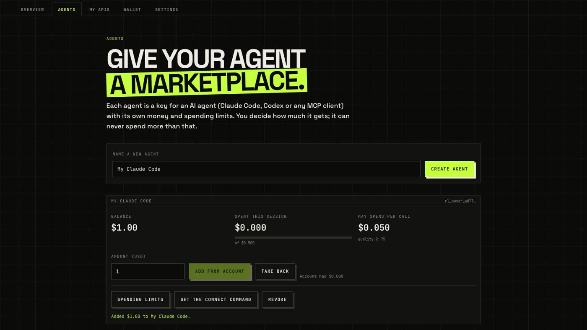

</td>
<td width="50%" valign="top">

### 🛠️ You built an API

Paste your endpoint, set a price, test it. You keep 100% of your price; buyers pay a small platform fee on top.

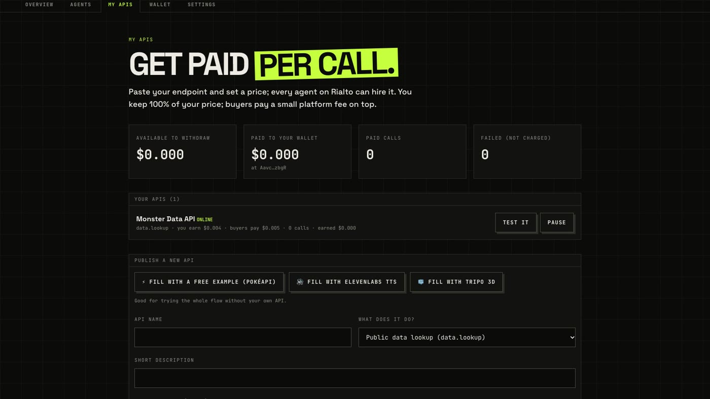

</td>
</tr>
<tr>
<td valign="top">

**The catalog.** 50+ real APIs (images, sprites, video, 3D models, music, sound effects, voices, transcription, language models), each with its price per call, plus clearly labelled demo providers.

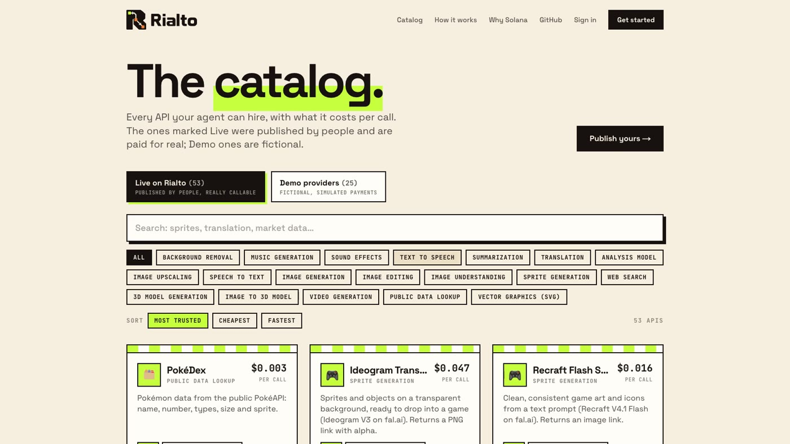

</td>
<td valign="top">

**In the terminal.** The agent checks its wallet, shops in parallel and downloads what it bought, without asking you for anything.

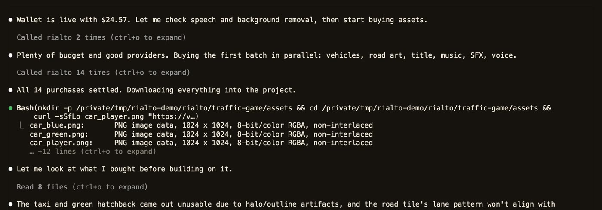

</td>
</tr>
<tr>
<td valign="top">

**The landing page.** A low-poly 3D market where the critter runs the errand in the headline.

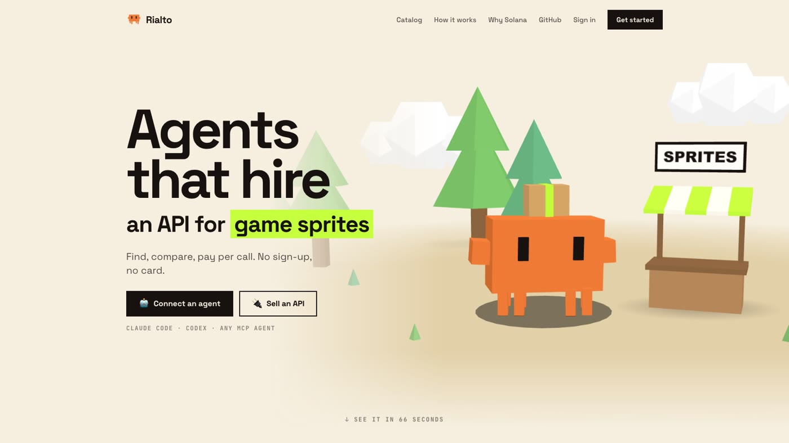

</td>
<td valign="top">

**On-chain.** Every paid call links to its transaction on the Solana explorer.

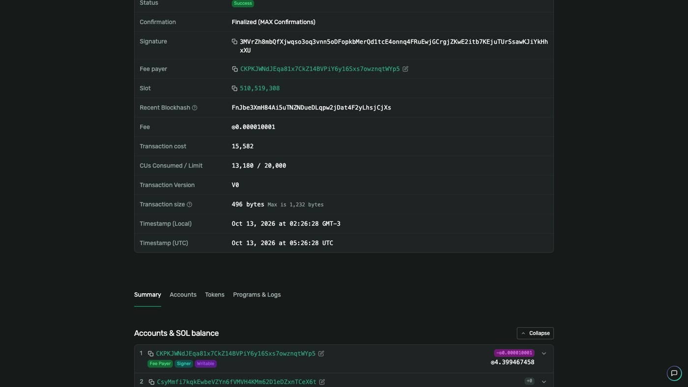

</td>
</tr>
</table>

## Connect your agent

Sign up at [galleriarialto.com](https://galleriarialto.com/signup) (new accounts start with test credit), create an agent, and paste the command it gives you:

```bash
# Claude Code
claude mcp add --transport http rialto https://galleriarialto.com/api/mcp \
  --header "Authorization: Bearer rl_buyer_…"
```

```toml
# Codex: ~/.codex/config.toml   (and: export RIALTO_KEY=rl_buyer_…)
[mcp_servers.rialto]
url = "https://galleriarialto.com/api/mcp"
bearer_token_env_var = "RIALTO_KEY"
```

Then just ask: *"Make a pixel-art sprite for my game's hero, use rialto."*

| MCP tool | What the agent does with it |
|---|---|
| `discover_services` | List who sells a capability |
| `compare_services` | Rank them by a priority (accuracy, cost, speed, balanced) and explain the winner |
| `get_provider_reputation` | Reputation, success rate, latency, recent outcomes |
| `plan_execution` | See the plan and the price without spending |
| `execute_service` | Plan, pay and run; returns the result and the receipt |
| `get_transactions` | What it has bought, with explorer links |
| `get_wallet_status` | Balance, spend this session, limits, payment mode |

## Run it locally

Requirements: **Node.js 20.9+** (22 recommended, see `.nvmrc`). No Docker and no external services: payments are simulated until you turn the live rail on.

```bash
git clone https://github.com/chicogborba/rialto.git
cd rialto
npm install
cp .env.example .env        # the defaults work as they are
npm run setup               # creates the SQLite database and seeds the demo market
npm run dev                 # http://localhost:3000
```

| URL | What |
|---|---|
| `/` | Landing page: the 3D story, the pitch video, the Solana race |
| `/demo` | The two games, the bill and the demo video |
| `/catalog` | Public catalog of everything an agent can hire |
| `/signup` · `/login` · `/dashboard` | Accounts: agents, APIs, wallet, settings |
| `/app` | Visual console: watch the decision engine plan, pay and run, step by step |

Check everything end to end, against a local or a deployed server:

```bash
npm run check                                       # typecheck + lint + unit tests (what CI runs)
npm run e2e:accounts                                # the whole two-sided flow on a local server
E2E_BASE=https://your.server npm run e2e:accounts   # or on a deployed one
```

The end-to-end script signs up two accounts, proves a wallet, publishes an API as one, has the other's agent hire it through the hosted MCP endpoint and checks the money to the micro-USDC. Then it rotates and revokes keys, changes a password and checks sessions. On the live rail it also makes a real USDC deposit.

### Turn on live payments (Solana devnet)

```bash
npm run x402:keys -- --live   # two devnet wallets in .env: one pays sellers, one is the test seller
# fund BOTH printed addresses with devnet USDC at https://faucet.circle.com (Solana Devnet)
npm run x402:check -- --pay   # one real $0.001 payment; prints the explorer link
npm run seed:pokedex          # the PokéDex test seller is now paid at that address
npm run dev                   # ask for "Look up the Pokémon pikachu." in /app
```

Sellers with a Solana payout address are paid on-chain; the fictional demo providers stay on the simulation, labelled `SIMULATED`, in the same run. First verified on devnet on 2026-10-08: [this transaction](https://explorer.solana.com/tx/hxEm488sPAtrE6QfkvWfNuLdBNsY5h8UFmxhUQJ3U79rYvaYashAHJTQSLbGfSC9ajtERDJWks7KnFSG4QXYnnh?cluster=devnet) paid the seller $0.002, the buyer was debited $0.003, and a run whose upstream returned 404 settled nothing and charged nothing.

## How the money works

The buyer pays `sellerPrice + max(floor, ceil(sellerPrice × bps / 10000))`. The seller receives **exactly** their price, the platform keeps the difference, and every movement is an append-only ledger entry. Defaults: 5%, with a $0.001 floor. Example: a seller price of $0.002 costs the buyer $0.003.

An account holds a balance and hands part of it to each agent. An agent can only spend what it was given, within its policy: maximum per call, allowed providers, minimum quality. Debits are atomic, so a wallet cannot be overdrawn by parallel calls.

## What is real and what is not

| Real and tested | Simulated or not built |
|---|---|
| x402 v2 payments in USDC on Solana devnet for real sellers: sign → verify → call → settle | **Mainnet.** The live rail is devnet only, by construction |
| USDC deposits from a wallet the user proved they hold (ed25519 signature), read from the chain | Payments to the 25 fictional demo providers (`sim_…` references, never an explorer link) |
| Seller gateway that calls the seller's real HTTPS API, SSRF-guarded, secrets encrypted at rest | Withdrawing an account balance back on-chain |
| 50+ first-party integrations (fal.ai, ElevenLabs, Tripo) and a public test seller (PokéAPI) | Email verification, password recovery, 2FA |
| Decision engine: qualify → score → plan → explain, multi-step plans, fallback, budget reserve | The planner is rule-based: it reads the goal with keyword scenarios, not an LLM |
| Accounts, hashed API keys, per-agent wallets and spending policy, commission split, ledger | Rate limiting is in memory (one instance); balances are 32-bit integers |
| Hosted MCP endpoint, dashboard, visual console, 3D landing page | Quality figures are self-reported; reputation starts at 50 and is earned |

## Under the hood

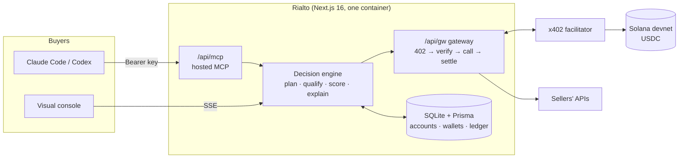

**Stack:** Next.js 16 (App Router) · React 19 · TypeScript · Tailwind 4 · Prisma + SQLite · `@x402/core` + `@x402/svm` · `@solana/kit` · Model Context Protocol SDK · three.js · Vitest · Docker + Traefik · Remotion (videos).

```
app/                 Next.js App Router
  page.tsx             landing page
  demo/ catalog/       the two games and the public catalog
  dashboard/           accounts: agents, APIs, wallet, settings
  app/                 visual console + marketplace, providers, transactions, reputation
  api/                 REST + SSE: runs, auth, account, sellers, gw (gateway), mcp (hosted MCP), x402
components/          UI (home/, landing/, account/, agent/, catalog/, visualizations/, …)
lib/
  agent/               planner, orchestrator (runAgent), reducer, scenarios
  routing/             qualification, scoring, explanations, savings
  x402/                payment rails (simulated, x402 on Solana, hybrid) and deposits
  gateway/             upstream caller, request templates, first-party integrations
  auth/ security/      sessions, wallet proof, keys, secrets (AES-GCM), SSRF guard, rate limit
  billing/ wallet/     commission math, spending policy
  db/                  Prisma client, repositories, seed
  mcp/                 tool definitions, shared by the stdio and HTTP servers
prisma/              schema + seed data
scripts/             end-to-end checks, devnet wallet tools, database admin
tests/               Vitest: engine, billing, policy, x402, accounts, platform
deploy/              docker-compose (Traefik + app) and the server setup script
video/               pitch and demo videos (a separate Remotion project)
docs/                architecture, deployment, credits
```

<details>
<summary><b>All commands</b></summary>

| Command | What it does |
|---|---|
| `npm run dev` | Dev server |
| `npm run build` / `npm start` | Production build / serve |
| `npm run setup` | Generate the Prisma client, create the SQLite database and seed it |
| `npm run db:reset` | Wipe and reseed the demo data |
| `npm run db:init` | What a server runs on start: seed an empty database, refresh the integrations |
| `npm run db:backup` | Consistent copy of the database into `prisma/backups/` (keeps the last 14) |
| `npm run check` | Typecheck + lint + unit tests |
| `npm run e2e:accounts` | End-to-end check of the whole account flow, on either rail (`E2E_BASE=https://…`) |
| `npm run e2e` | Older end-to-end check with keys that have no account (needs `PAYMENT_MODE=simulated`) |
| `npm run user:admin` | `list` accounts, `reset-password <email>`, `purge <domain>` |
| `npm run mcp` | Local stdio MCP server (development; agents normally use `/api/mcp`) |
| `npm run x402:keys` | Create the devnet wallets the live rail needs, in `.env` (`-- --live` also switches it on) |
| `npm run x402:check` | Wallets, balances and facilitator of the live rail (`-- --pay` makes one real $0.001 payment) |
| `npm run seed:pokedex` | Add the PokéDex test seller, or re-point it at `SOLANA_PAY_TO` |
| `npm run build:pages` | Static export of the landing page into `./out` (GitHub Pages) |

</details>

<details>
<summary><b>Configuration (<code>.env</code>)</b></summary>

| Variable | Default | Meaning |
|---|---|---|
| `DATABASE_URL` | `file:./dev.db` | SQLite file (relative to `prisma/`) |
| `PAYMENT_MODE` | `simulated` | `live` pays real sellers with x402 on Solana devnet (needs `SOLANA_PAYER_SECRET_KEY`) |
| `SOLANA_PAYER_SECRET_KEY` | – | Devnet wallet that pays sellers (base58 secret key). Holds devnet USDC; needs no SOL |
| `SOLANA_PAY_TO` | – | Payout address of the PokéDex test seller and of the first-party integrations |
| `X402_FACILITATOR_URL` | `https://x402.org/facilitator` | Verifies and submits the payments, and pays their fees |
| `SOLANA_RPC_URL` | `https://api.devnet.solana.com` | Devnet RPC used to build the payment transaction |
| `LIVE_DAILY_CAP_USD` | `5` | Most the platform wallet pays sellers per 24 hours on the live rail |
| `PLATFORM_FEE_BPS` | `500` | Platform commission in basis points (500 = 5%) |
| `PLATFORM_MIN_FEE_MICRO` | `1000` | Commission floor per call, in micro-USDC ($0.001) |
| `WELCOME_CREDIT_MICRO` | `1000000` | Test credit every new account starts with |
| `MIN_PAYOUT_MICRO` | `10000` | Minimum seller withdrawal ($0.01) |
| `SECRETS_KEY` | – | **Required in production.** `openssl rand -base64 32`; encrypts sellers' upstream secrets |
| `ADMIN_TOKEN` | – | In production, the bearer token allowed to reset the demo data; unset = nobody can |
| `ALLOW_ANONYMOUS_KEYS` | off in production | `1` lets scripts create keys without an account |
| `ALLOW_PRIVATE_UPSTREAMS` | `0` | `1` allows http/localhost upstreams (development only) |
| `INTERNAL_BASE_URL` | – | Behind a proxy: where the server reaches itself, e.g. `http://127.0.0.1:3000` |
| `INTERNAL_TOKEN` | random | Set when running more than one instance |
| `NEXT_PUBLIC_APP_URL` | `http://localhost:3000` | Public address, used in the connect commands and by the scripts |
| `FAL_KEY`, `ELEVENLABS_API_KEY`, `TRIPO_API_KEY` | – | Optional. Each one switches on the first-party integrations that use it |
| `OPERATOR_DAILY_CAP_USD` | `5` | Most those integrations may sell per 24 hours: every call spends the keys above |

</details>

## Team

| | |
|---|---|
| **Francisco** | Full-stack, computer vision, 3D and motion |
| **Rodrigo** | Backend, web3, pitching |
| **Isadora** | Product, market research, iOS |

## Documentation

- [docs/ARCHITECTURE.md](docs/ARCHITECTURE.md): the decision engine, the ranking formula, how x402 fits, accounts, the security model, limitations
- [docs/DEPLOYMENT.md](docs/DEPLOYMENT.md): running the platform on a server (Docker, Traefik, GitHub Actions) and the static landing page
- [docs/CREDITS.md](docs/CREDITS.md): third-party assets and licences
- [video/README.md](video/README.md): how the pitch and demo videos are made

## Credits

Music in the videos: "Getting it Done" by Kevin MacLeod (CC BY 4.0). Narration by ElevenLabs. The orange critter is an original character inspired by the Claude Code mascot, an Anthropic trademark. Details in [docs/CREDITS.md](docs/CREDITS.md). No project licence has been chosen yet.

<div align="center">
<sub>Built for a Solana hackathon · devnet test money, never real funds</sub>
</div>
